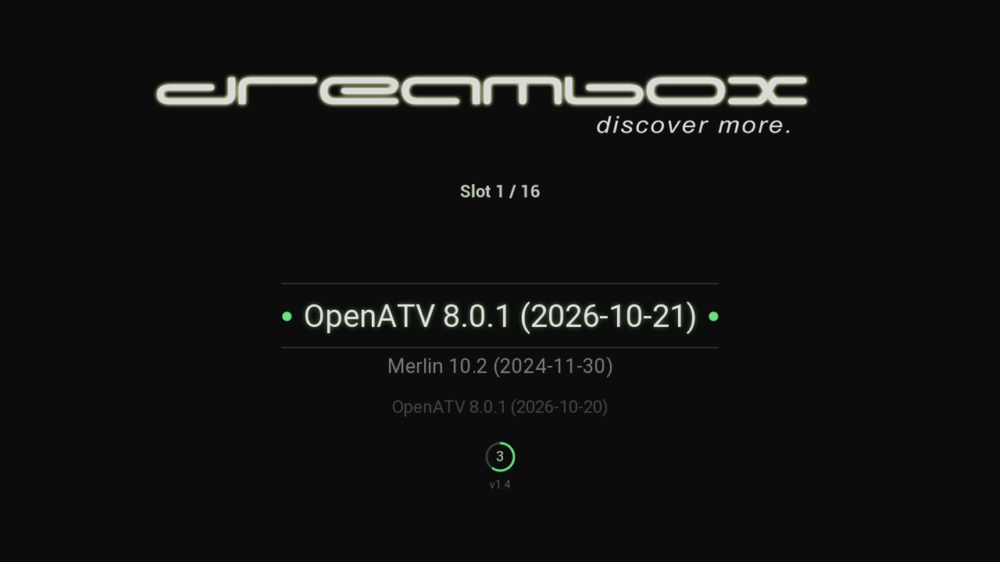

# Boot menu for the Dreambox One and Two

Replaces the boot menu built into the Dreambox u-boot (`dm_bootmenu`) on boxes
with the GPT multiboot layout. It reads the same `/data/bootconfig.txt`, so
nothing new has to be configured, but it is not limited to eight entries, shows
the Dreambox logo with a scrolling list and is driven by the Dreambox remotes,
infrared and Bluetooth.

## How it hooks in

The Dreambox u-boot runs

    if ext4load mmc 1:6 ${loadaddr} /boot/autoexec.img; then autoscr ${loadaddr}; fi

before its own menu. On a GPT box partition 6 is the root file system of the
second slot. Images with the Dreambox flash scripts (openATV, Gemini,
Newnigma2, ...) build that `autoexec.img` with `update-autoexec` from all
`/etc/u-boot.scr.d/*.scr`, and they rebuild it whenever the video mode
changes. `bootmenu.scr` is one more of these snippets, so it ends up in every
rebuild of the image in slot 2. It is only a stub:

    if ext4load mmc 1:4 0x03900000 /bootmenu/bootmenu.img; then autoscr 0x03900000; fi

`mmc 1:4` is the data partition, so it runs `/data/bootmenu/bootmenu.img`,
built from `bootmenu.cmd`. That script and the program always come together,
the stub never changes, and openATV images bring it along already. Without
`/data/bootmenu` the stub does nothing.

The script loads `bootmenu.bin` from `/data/bootmenu/` and starts it with
`go`. The program shows the menu and hands the chosen entry back; the script
then puts it into `bootcmd` and lets u-boot continue. `dm_bootmenu` finds no
`loadaddr` and gives up without a menu, u-boot initialises the network (so
the kernel gets the real MAC address) and boots the chosen entry.

## Using the menu

The menu comes up when the box starts, after the Dreambox logo. The entry in
the middle, between the two lines, is the one that starts.

| key on the remote | what it does |
|---|---|
| up / down | moves to the entry above or below; held, it keeps moving |
| left | jumps to the first entry |
| right | jumps to the last entry |
| OK | starts the entry in the middle |
| OK held while the box starts | brings the menu even with `timeout=0`, without a countdown |

The ring at the bottom counts the seconds until the selected entry starts on
its own. Up, down, left or right stop the countdown; the ring then shows "OK",
and nothing starts until OK is pressed. The dots left and right of an entry
mark the default one, the entry that starts on its own and is selected when
the menu comes up. Which entry is the default, and how long the countdown
runs, is set in the image's multiboot settings (`default=` and `timeout=` in
`/data/bootconfig.txt`).

"IR" left of the ring or "BT" right of it lights up for a second whenever a
key arrives, by infrared or by Bluetooth. The line "Slot 3 / 16" above the
list says which of how many entries is selected, the number below the ring
is the version of the boot menu.

Every Dreambox remote of the One and Two works, by infrared as well as by
Bluetooth. A remote switched to its TV mode sends codes for the TV, which the
menu does not take.

On the serial console (115200 baud), `u`, `d`, `f`, `l` and Return or the
arrow keys do the same as up, down, left, right and OK; `q` or Ctrl+C leaves
the menu, and the built-in menu follows.

## What the menu does

**Normally** it shows the logo and the entries of `bootconfig.txt`, the
`default=` entry selected and marked with a dot left and right of it, and a
countdown of `timeout=` seconds in the ring at the bottom. The countdown runs
down to 0 like the built-in menu, then the selected entry starts. Up, down,
left or right stop it, and a ring around "OK" stands where the countdown was.

**With `timeout=0`** there is no logo and no menu, the default entry starts
right away. The built-in menu does the same, but rejects such a file and
starts whatever u-boot has stored instead.

**OK held on the remote while the box starts** always brings the menu,
without a countdown, also with `timeout=0`. Then a yellow line "Menu forced
by OK" below the ring says why the menu is there.

**Without `/data/bootconfig.txt`, or with an empty one**, the built-in menu
has nothing to show and boots whatever u-boot has stored, on the GPT layout
possibly a kernel with the wrong root. The boot menu takes over instead:

- the script loads the copy `install.sh` keeps as
  `/data/bootmenu/bootconfig.bak`, refreshed on every run from a
  `bootconfig.txt` with entries; a red line below the ring says "bootconfig.txt
  is missing, these entries come from its backup"
- without that copy too, the menu offers fixed entries for the five eMMC
  slots ("Fallback Slot 1" to "Fallback Slot 5") and the recovery, the second
  slot as default, as it holds the image that started the menu; the red line
  says "bootconfig.txt and its backup is missing, these are available
  fallback entries"

In both cases there is no countdown, nothing starts until OK is pressed.

**The built-in menu stays as a way out.** It comes up as before when

- `bootmenu.bin` or `bootmenu.img` is missing, or `/data/bootmenu` altogether
- the program returns no choice
- `q` or Ctrl+C is pressed on the serial console (115200 baud); the console
  is checked once before anything is drawn, so this works even if drawing
  should fail

**The picture** is always 1080p50 in RGB. 1080p50 is the mode the built-in
menu uses and every TV takes; RGB is what every HDMI TV has to take, while
some, such as older Panasonic plasmas, show nothing of the YCbCr u-boot sends
otherwise. The image in the second slot may have set no mode or another one,
e.g. 1080p60, and the colour space only changes together with the mode, so
the script sets both. A TV then needs a few seconds before it shows the
picture again, so the countdown may already have started when the menu
appears. The image that starts sets its own mode and colour space.

**The remotes:** infrared remotes send NEC codes, on addresses `0x32` to
`0x35` with the same two key tables as the Linux driver. A Bluetooth remote
sends its first press by infrared and the rest over Bluetooth to the front
processor of the box, which passes its key reports on over a UART of its own;
the menu reads both. The console logs every key with where it came from and
its code.

## Installing

From the feed on openATV:

    opkg install dreambox-bootmenu

On any other image with the Dreambox flash scripts (no package manager
needed), as root:

    curl -fsSL https://github.com/oe-alliance/dreambox-bootmenu/releases/latest/download/install.sh | sh
    wget -qO- https://github.com/oe-alliance/dreambox-bootmenu/releases/latest/download/install.sh | sh

`install.sh` unpacks the archive of the latest release into `/data/bootmenu`,
puts `bootmenu.scr` into the image in the second slot and rebuilds its
`autoexec.img`. It checks first that it runs on a Dreambox One or Two, that
`/data` is mounted, that the eMMC has a GPT with the multiboot layout and that the
second slot holds an image. `--remove` (`| sh -s -- --remove`) takes the boot
menu out again, `--no-download` only sets up the second slot from the files
already in `/data/bootmenu`; the package uses that.

An older release (1.1 or later) is installed with `--version`:

    curl -fsSL https://github.com/oe-alliance/dreambox-bootmenu/releases/latest/download/install.sh | sh -s -- --version 1.1
    wget -qO- https://github.com/oe-alliance/dreambox-bootmenu/releases/latest/download/install.sh | sh -s -- --version 1.1

Without the option, or after `--remove` and a new install, the latest release
is used again.

An openATV image flashed into the second slot brings the stub along, so the
boot menu stays. With other images the boot menu is gone until it is set up
again. `install.sh` stays in `/data/bootmenu`, so this works from any slot
without a download, by hand or from a start script:

    /data/bootmenu/install.sh --no-download

## Files

| file | where it goes |
|---|---|
| `bootmenu.bin`, `bootmenu.img`, `bootlogo.bmp`, `bootmenu.scr`, `install.sh`, `NOTICE`, `LICENSE`, `LICENSE.fonts` | `/data/bootmenu/` |
| `bootmenu.scr` (the stub) | also `/etc/u-boot.scr.d/` of the image in slot 2 |
| `bootconfig.bak`, a copy of `/data/bootconfig.txt` | `/data/bootmenu/`, written by `install.sh` |

## The program

A u-boot standalone program, started as

    go <load> <cfg> <cfglen> <result> [<fb> [<width> <height> [<logo> [<copy> [<mode>]]]]]

- `cfg`/`cfglen`: `bootconfig.txt`, already loaded by the script
- `result`: where the choice is written
- `fb`: the framebuffer, `0x${initrd_high}` as u-boot set it up for the logo
- `logo`: `bootlogo.bmp` as loaded by the script (RGB565, screen size); it is
  drawn only when the menu shows
- `copy`: 1 when `cfg` is `bootconfig.bak`, for the note below the ring
- `mode`: u-boot's `outputmode`, used in `arg=` of the fallback entries
  (1080p50hz without it)

The result is a magic (`0x4d454e55`), a zero word, the index and the length
of a text block with `bm_sel`, `bm_title`, `bm_cmd` and `bm_arg` for
`env import -t`. `bm_arg` is the `arg=` line without the literal
`${bootargs}` the built-in menu passes on.

Titles are UTF-8 (a byte order mark is skipped); the fonts cover ASCII,
Latin-1, Latin Extended-A and the extra characters of Windows-1252 (euro
sign, typographic quotes and dashes), anything else is drawn as `?`.

Of the global keys it uses `default=` and `timeout=`; `fb_pos`, `fb_size`
and `font_size` belong to the layout of the built-in menu and are ignored.

## Building

    make CROSS=aarch64-oe-linux-

The program's sources are in `src/`; `bootmenu.bin` is built in the top
directory, next to `bootmenu.scr`, `bootlogo.bmp` and `install.sh`.
`bootmenu.img` is built from `bootmenu.cmd` and needs `mkimage`.

The program uses no libc and no FP registers, keeps `x18` free (u-boot's
global data pointer) and has no `.data` or `.bss`, so the raw image can be
loaded and run as is at `0x03000000`. The script lies at `0x03900000` and
loads `bootconfig.txt` to `0x03800000`, well above the program.

`src/fonts.h`, `src/fonts_bold.h` and `src/fonts_small.h` are generated by
`mkfont.py` from the Roboto fonts in `fonts/` (Apache License 2.0, see
`fonts/LICENSE`); `make fonts` regenerates them and needs Pillow.

## Remote test

    make CROSS=aarch64-oe-linux- irtest

builds `bootmenu-irtest.bin`. Put in place of `/data/bootmenu/bootmenu.bin`, it
shows no menu but asks for 3x up, 3x down and 3x OK and logs every IR frame
to the serial console (115200 baud): the NEC code with address and command,
or for any other protocol the lengths of all edges in microseconds, and every
frame of the front processor, with the keys of a Bluetooth remote. After 60 s,
or `q` on the console, the built-in menu follows and the box starts as usual.
With such a log another remote can be added.

## Releases

The version is `BOOTMENU_VERSION` in `src/menu.c`. When it changes on master, a
workflow tags `v<version>` and publishes a release with two files:
`install.sh` for the one-liner and `dreambox-bootmenu.tar.gz` with all files
above. `install.sh` unpacks the archive of the latest release, packages such
as the OE recipe take the archive of their version, so every installation
runs the binary built by the release. Every push is built and checked by the
build workflow.

## License

Copyright (C) 2026 OE-Alliance. GPL-3.0, see `LICENSE`. The fonts in
`fonts/` and the glyph data generated from them are Apache License 2.0, see
`fonts/LICENSE`. `NOTICE` sums this up and is installed with `LICENSE` and
`LICENSE.fonts` into `/data/bootmenu`.
